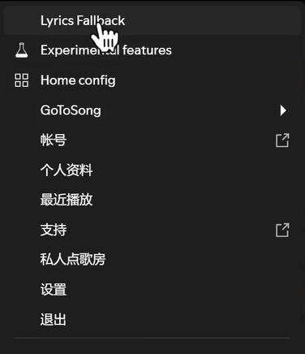
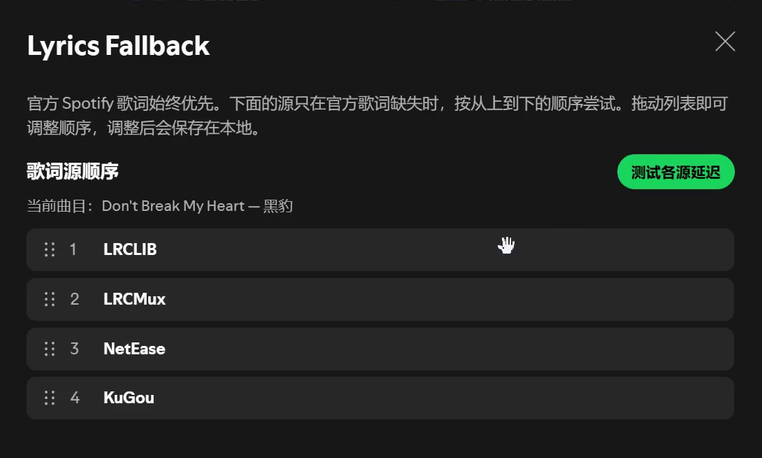

# lyrics-fallback

<div align="center">

[](https://afdian.com/a/leonyew)
[](https://ko-fi.com/leonyew)

**Languages** · [中文](README.md) · [English](README_EN.md)

</div>

这是一个 [Spicetify](https://spicetify.app) 扩展，使用 Spotify 官方歌词界面。官方歌词始终优先；只有在官方歌词缺失时，才会按顺序尝试备用歌词源。

界面语言跟随 Spotify 客户端（目前支持中文和英文）。

## 效果

备用歌词会显示在 Spotify 官方歌词面板中：


## 安装

请先安装 [Spicetify](https://spicetify.app)（官方文档：[spicetify.app](https://spicetify.app) 或 [spicetify.co](https://spicetify.co)），再安装本扩展。本扩展依赖 Spicetify 提供的接口，Marketplace 与手动安装都需要先完成 Spicetify 的安装与应用。

### Marketplace

在 Spotify 中打开 Spicetify Marketplace，搜索 **Lyrics Fallback** 并安装（需本扩展已上架）。

### 手动安装

手动安装同样需要已安装并应用过 Spicetify。仅把文件复制到扩展目录，并不能在未安装 Spicetify 的 Spotify 中使用本扩展。

1. 将仓库中的 `dist/lyrics-fallback.js` 复制到 Spicetify 扩展目录：
   - Windows：`%APPDATA%\spicetify\Extensions\lyrics-fallback.js`
2. 在终端中运行：

```bash
spicetify config extensions lyrics-fallback.js
spicetify apply
```

然后重新打开 Spotify。

## 使用方法

点击 Spotify **右上角头像**，在菜单中选择 **Lyrics Fallback**。





在设置页可以：

- 拖动列表调整备用歌词源的优先级，松开后会保存到本地
- 点击「测试各源延迟」，并行测试各源，结果会显示在对应行上
- 当顺序与默认不同时，标题旁会出现重置图标，点击即可恢复默认顺序（LRCLIB、LRCMux、NetEase、KuGou）

官方 Spotify 歌词不在此列表中，始终优先。

开发说明见 [docs/development.md](docs/development.md)。
