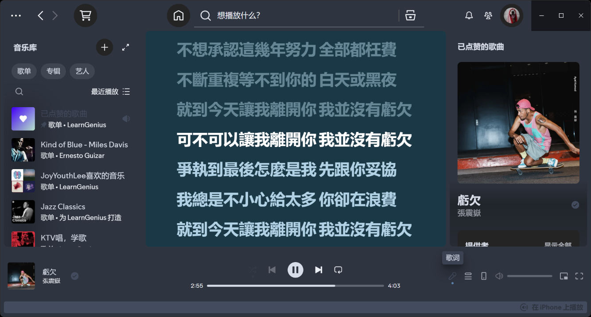
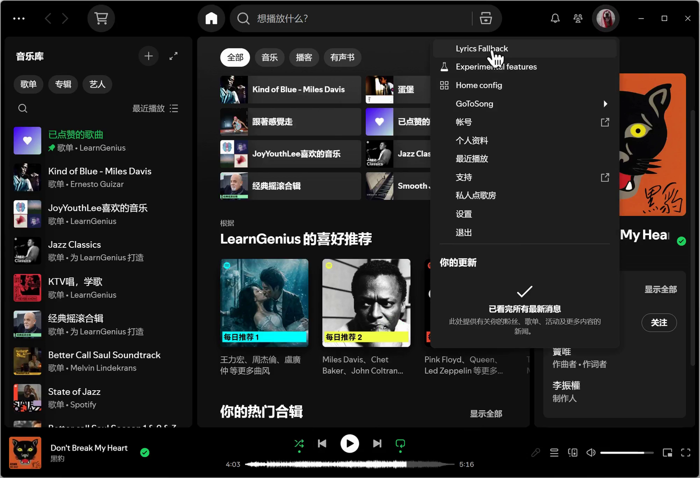
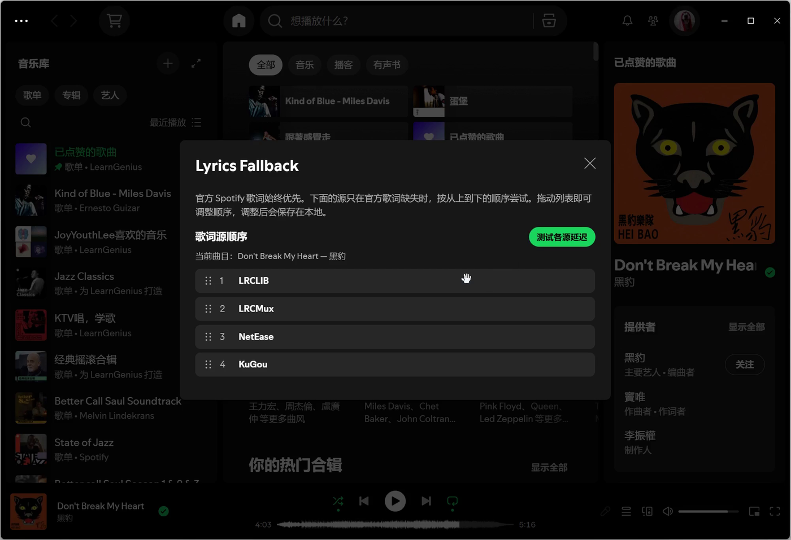

# lyrics-fallback

<p>
  <a href="https://afdian.com/a/leonyew"></a>
  &nbsp;
  <a href="https://ko-fi.com/leonyew"></a>
</p>

[中文](README.md) | [English](README_EN.md)

A standalone [Spicetify](https://spicetify.app) extension that uses Spotify’s native lyrics panel. Official Spotify lyrics always win. Fallback sources are tried in order only when official lyrics are missing.

The settings UI follows Spotify’s language (Chinese and English for now).

## Effect

Fallback lyrics appear in Spotify’s built-in lyrics panel:



## Install

Install [Spicetify](https://spicetify.app) first (official docs: https://spicetify.app or https://spicetify.co), then install this extension.

### Marketplace

Open Spicetify Marketplace in Spotify, search for **Lyrics Fallback**, and install it (once the extension is listed).

### Manual install

1. Copy `dist/lyrics-fallback.js` from this repository to the Spicetify extensions folder:
   - Windows: `%APPDATA%\spicetify\Extensions\lyrics-fallback.js`
2. Run:

```bash
spicetify config extensions lyrics-fallback.js
spicetify apply
```

## Settings

Click the **profile avatar** in the top-right corner of Spotify, then choose **Lyrics Fallback**.





In the settings page you can:

- Drag the list to change fallback provider priority; the order is saved when you drop
- Click **Test source latency** to probe all sources in parallel; each row shows its own result
- When the order differs from the default, a reset icon appears next to the heading and restores LRCLIB, LRCMux, NetEase, then KuGou

Official Spotify lyrics are not part of this list and still always win.

Developer notes are in [docs/development.md](docs/development.md).
